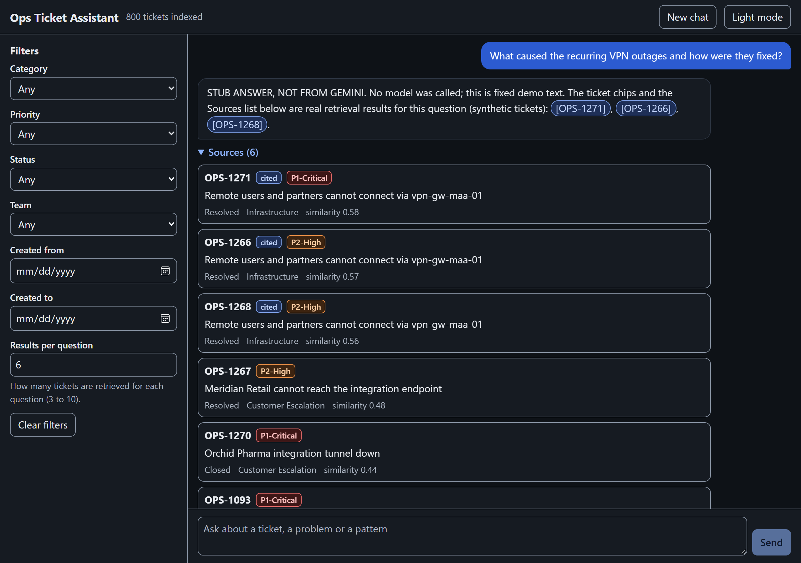
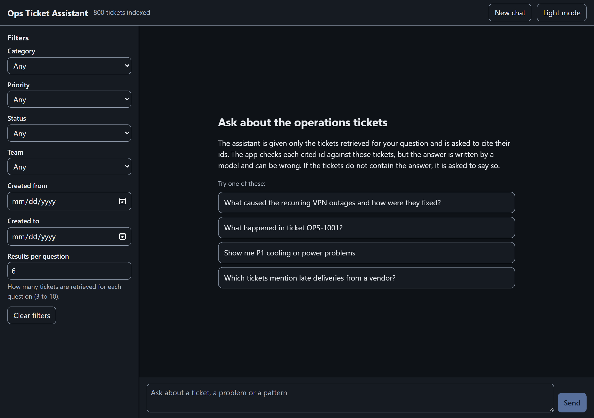
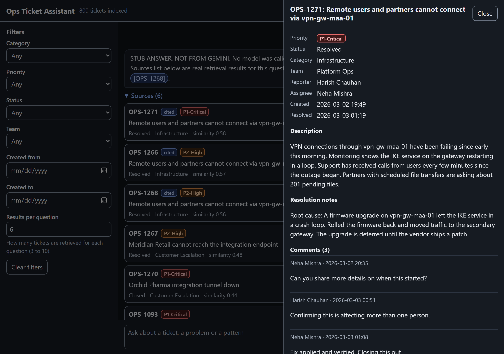
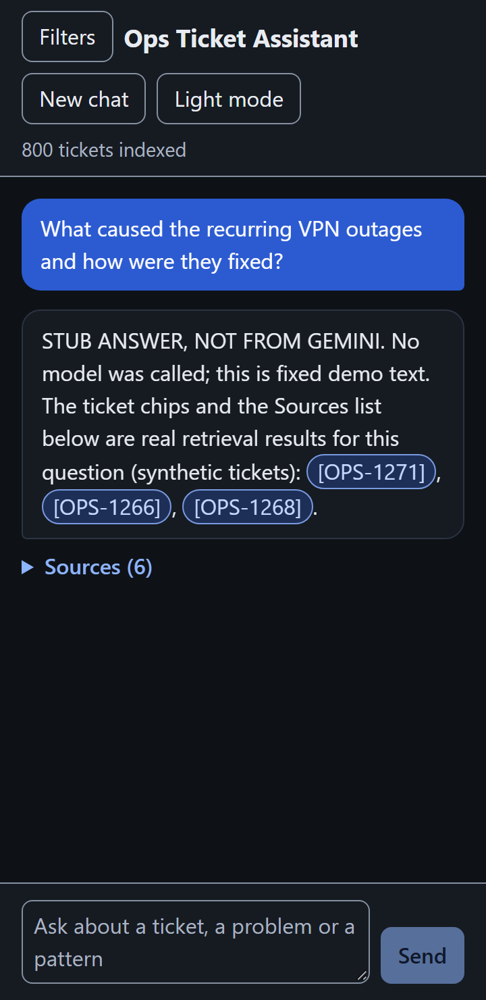

# ops-rag

Ask questions about 800 **synthetic** operations tickets (vendor invoices, VPN outages, stock shortages, access problems and so on) and get answers that point to the tickets they come from. The tickets are indexed locally; Google Gemini is asked to answer from the tickets that were retrieved and to cite their ids, and the app checks every cited ticket id against that set. A small web chat shows the answer, the ticket chips and the sources.



All data is synthetic. The tickets, names, vendors and numbers are generated by `scripts/generate_tickets.py` (seed 42); nothing in them is real.

## What it does
- **Grounded answers.** The model is given only the retrieved tickets and is instructed to cite a ticket id for every claim and to say "not found" when the tickets do not answer. The app checks each cited id against the retrieved tickets: an id that was not retrieved is shown as muted text instead of a link. It does not check that a cited ticket really supports the claim.
- **Exact references.** Ticket ids (`OPS-1001`) and PO or invoice numbers (`PO-180649`, `INV-308701`) named in a question are looked up directly, because vector search ranks ids poorly.
- **Follow-up questions.** After a question about one ticket, a short follow-up such as "What was the root cause?" keeps that ticket first in the context; a question about something new starts a fresh search.
- **Filters.** Category, priority, status, team and a created-date range, applied to the search.
- **Ticket drawer.** Click a chip or a source to read the full ticket, including comments and the resolution.
- **Errors you can act on.** A failed request shows an inline message with Retry; a rate limit shows a countdown from the server's `Retry-After`.
- **Light and dark theme, a narrow-screen layout, keyboard operation.**







The screenshots use a stub in place of the model and were taken with headless Edge 156 on 2026-11-05.

## How it works
```
data/tickets.json (800 tickets)
  -> scripts/ingest.py: one document per ticket, embedded locally (all-MiniLM-L6-v2)
  -> ChromaDB (chroma_db/, persistent, cosine similarity)

question (+ filters, + chat history)
  -> app/rag.py: exact-id lookup (OPS / PO / INV), follow-up rule, vector search above a similarity threshold (0.30)
  -> app/prompt.py: the retrieved tickets as delimited, escaped data, plus a details line per ticket
  -> app/llm.py: Gemini with a JSON schema (answer, found, citations), own retry with backoff for 429 / 503
  -> app/rag.py: citations checked against the retrieved tickets
  -> app/main.py (FastAPI) -> static/ (plain HTML, CSS and JS)
```
- **Retrieval first.** Embedding and search run on your machine. Only the question, the retrieved tickets and the last few chat turns are sent to Gemini.
- **Follow-up rule.** If a question names no ticket and only asks about a property of the previous one ("who", "when", "root cause", "it"), the ticket from the earlier turn is kept first in the context and nothing else is searched. Any other wording counts as a new topic. The rule is word-list based, so unusual wording can end the inheritance.
- **Citations.** The model's cited ids are kept only if they are in the retrieved set. Ids it mentions that were not retrieved are returned as `unverified_citations`.
- **Quota guard.** After a Gemini 429 whose retry delay is long ("quota used up") the server remembers the reset time and refuses model questions with a 429 and a `Retry-After` header until then, without sending a request. A wait hint from Gemini counts for at most one day, and a hint that is negative or not a finite number is ignored.

## Quick start
You need Git, Python and a free Gemini API key ([Google AI Studio](https://aistudio.google.com/apikey), sign-in required). Needs internet for `pip` and for the first model download (about 90 MB). Tested with **Python 3.13 on Windows 11**; Python 3.11 or newer is the intended range but was not tried.

**Windows (PowerShell)**
```powershell
git clone https://github.com/ecamorais/Rag-Ops.git
cd Rag-Ops
python -m venv .venv
.venv\Scripts\Activate.ps1
pip install -r requirements.txt
copy .env.example .env
notepad .env                      # set GEMINI_API_KEY=your-key
python scripts/ingest.py --reset  # builds the local index; prints "Tickets indexed : 800"
netstat -ano | findstr :8000      # no output means port 8000 is free
uvicorn app.main:app --port 8000
```
If PowerShell blocks the activation script, skip it and call `.venv\Scripts\python` and `.venv\Scripts\uvicorn` directly.

**macOS / Linux** (the standard equivalents; not run by the author)
```bash
git clone https://github.com/ecamorais/Rag-Ops.git
cd Rag-Ops
python3 -m venv .venv
source .venv/bin/activate
pip install -r requirements.txt
cp .env.example .env
nano .env                         # set GEMINI_API_KEY=your-key
python scripts/ingest.py --reset
uvicorn app.main:app --port 8000
```

Then open <http://127.0.0.1:8000/>. If port 8000 is busy, use another one (`--port 8001`).

On the author's Windows machine a fresh install took about 3 minutes (1.4 GB virtual environment) and the first ingest, including the model download, about 1 minute. Your times will differ.

**Without a key** everything except answering works: the page, filters, ticket drawer, `/search` and `/tickets`. A question that needs the model (one for which at least one ticket was retrieved) returns the error `GEMINI_API_KEY is not set` (HTTP 500, code `server_misconfigured`); a question that retrieves nothing is answered without the model.

### Command line
```
python scripts/ask.py                       # interactive, keeps history; type "exit" to quit
python scripts/ask.py --once "What happened in ticket OPS-1001?" --priority P4-Low
python scripts/try_search.py "vpn outage" --k 3 --category Infrastructure   # search only, no model call
python scripts/generate_tickets.py          # regenerate data/ (the output is reproducible; the files are already committed)
python scripts/evaluate.py                  # retrieval-only evaluation on stdout (stub model, no key, no Gemini call; needs the index)
```
`ask.py` makes real Gemini calls and accepts `--k`, `--category`, `--priority`, `--status` and `--team`.

## Things to try
Example questions. The answers are written by the model and can vary or be wrong; the retrieval behind the first two is part of the evaluation (see Evaluation).
- "What caused the recurring VPN outages and how were they fixed?"
- "What happened in ticket OPS-1001?", then "What was the root cause?" and "Who was the assignee?"
- "Who resolved OPS-1001?" (the ticket text does not say who fixed it, so a good answer says that; a model has been seen to name the assignee instead, see Known limits)
- "Show me P1 cooling or power problems"
- "Which tickets mention late deliveries from a vendor?"

## API
JSON in and out. Errors are `{"error": "...", "code": "..."}`; a 422 from request validation uses FastAPI's usual `detail` list. Unknown request fields are rejected. A body with a lone surrogate (JSON `"\ud800"`) or a number that is not finite (`NaN`, `Infinity`, `1e999`) is also answered with that 422; the surrogate is written as an ASCII escape and the number as the string `"NaN"`, `"Infinity"` or `"-Infinity"`. Interactive docs: `/docs`.

| Method and path | What it does |
|---|---|
| `GET /health` | `status` (`ok` or `degraded`), `indexed_tickets`, `model`, `key_configured` |
| `GET /filters` | The distinct category, priority, status and team values, and `created_min` / `created_max` |
| `POST /search` | Raw vector search for debugging, no model call. Body: `query`, `k`, `filters`. Returns every hit with `similarity` and `above_threshold` |
| `GET /tickets/{id}` | The full ticket. `id` must look like `OPS-1001` (422 otherwise, 404 if unknown) |
| `POST /chat` | The answer. Body: `question`, `k`, `filters`, `history`. Returns `answer`, `found`, `citations`, `sources`, `retrieved_count`, `unverified_citations`, `missing_references`. The only route that calls Gemini |
| `GET /` and other paths | The static chat UI from `static/` |

Limits: `question` 1 to 1000 characters; `k` 1 to 15 (default 6; the UI offers 3 to 10); `history` at most 12 turns of at most 4000 characters, roles `user` and `assistant`; `filters` accepts `category`, `priority`, `status`, `team` and `date_from` / `date_to` as `YYYY-MM-DD`.

## Tests
```
python scripts/ingest.py --reset   # the Python tests need the index
pytest                             # the Python tests, plus the front-end tests through a wrapper
node tests/ui/run_all.js           # the front-end tests alone
```
As of 2026-11-05 the full `pytest` run passes; one test is skipped because it has nothing to check in this data set. [CLAUDE.md](CLAUDE.md) lists the counts per file.

- **API and RAG core** (`tests/test_*.py`). The real app runs on a temporary copy of `chroma_db/` (never the original) with the model replaced by a stub, and a guard fails any test that tries to create a real Gemini client, so no request goes to Gemini. They cover request validation and limits, error handling and retries, the quota guard, citation checks, exact-id lookup, filters, follow-ups, prompt escaping and the security headers. They need `chroma_db/`, `data/tickets.json` and the local embedding model; without an index they are skipped with a message.
- **Golden question set** (`tests/test_golden_labels.py`). Checks the labelled tickets of the evaluation questions against the data and pins the file's hash (see Evaluation).
- **Front end** (`tests/ui`, plain Node.js, no packages to install; tested with Node v26.8.1 only). These run on a fake DOM, not in a real browser. `pytest` runs them through `tests/test_ui_node.py` and skips them, with a reason, when `node` is not installed.
- **Break controls.** The front-end tests come with mutation checks in `tests/ui/breaks` (each changes a copy of `static/app.js` and a test must fail). The Python tests were checked the same way on temporary copies, but those scripts are not kept in the repository.
- **Text scan.** `tests/test_prompt_escaping.py` also scans `static/` as text for forbidden APIs. That is a tripwire, not a proof that the page is safe.
- **Not covered:** a real browser (the headless Edge run mentioned under Known limits is not in the repository) and real Gemini answers.

## Evaluation
`python scripts/evaluate.py` sends the 33 questions of `tests/golden_questions.json` through the real retrieval, with a stub in place of the model, and compares the retrieved tickets with the labelled ones. Full tables: [docs/evaluation.md](docs/evaluation.md).
- It measures retrieval only. It says nothing about whether an answer is correct or its citations are right.
- The labelled tickets are a lower bound: other tickets can also fit a question.
- The set is frozen (2026-10-27) and pinned by a hash test. The 5 extra questions were drafted by the assistant and are not blind; they have their own row and are not in the headline.
- A re-run on 2026-11-05 reproduced the same results apart from the run date.

Results at k = 6, the number of tickets the app retrieves by default. Hit rate: at least one labelled ticket found. Recall: labelled tickets found / labelled tickets. Capped recall: the same, divided by the smaller of k and the number of labelled tickets. MRR: mean reciprocal rank of the first labelled ticket.

| Group (k = 6) | n | Hit rate | Recall | Capped recall | MRR |
|---|---|---|---|---|---|
| exact id | 3 | 1.00 | 1.00 | 1.00 | 1.00 |
| cluster / topic | 10 | 1.00 | 0.64 | 0.64 | 0.57 |
| vague ticket | 3 | 1.00 | 1.00 | 1.00 | 1.00 |
| near-duplicate pair | 4 | 1.00 | 0.88 | 0.88 | 0.68 |
| with filters | 4 | 1.00 | 1.00 | 1.00 | 0.88 |
| **headline: without the extra type** | **24** | **1.00** | **0.83** | **0.83** | **0.74** |
| headline: all types except known-weak (includes the 5 not-blind extra questions) | 29 | 0.97 | 0.79 | 0.81 | 0.71 |
| known weak: aggregation / counting (G23, G24) | 2 | 0.50 | 0.10 | 0.10 | 0.08 |
| known weak: vocabulary mismatch (G25) | 1 | 1.00 | 1.00 | 1.00 | 1.00 |
| extra, assistant-drafted, not blind | 5 | 0.80 | 0.60 | 0.70 | 0.57 |

The headline without the extra type at the other cut-offs:

| k | n | Hit rate | Recall | Capped recall | MRR |
|---|---|---|---|---|---|
| 3 | 24 | 0.79 | 0.66 | 0.74 | 0.70 |
| 10 | 24 | 1.00 | 0.93 | 0.93 | 0.74 |

- **Exact ids and filters.** The fourth exact-id question asks for a ticket that does not exist (OPS-9999); it passes at every k (nothing retrieved, the id reported as missing). With filters, every retrieved ticket respected the filter (30 hits checked at k = 6, 0 violations).
- **Counting does not work.** G23 ("Which vendor has the most delayed delivery tickets?") finds none of its 3 labelled tickets at k = 3, 6 or 10. G24 ("How many tickets are there about cooling failures in the Bengaluru server room?") finds 0, 1 and 5 of its 5 at k = 3, 6 and 10: the tickets only show up when 10 are retrieved, and retrieving tickets is not counting them. No counting route is built.
- **G25 did not fail.** "Who could not log in to the HQ server room?" (the tickets say "badge in") found all 3 labelled tickets at k = 3. It is one question, so it says little.
- **Competing tickets.** For G07 (cooling in the Bengaluru server room) the data holds more tickets than the 5 labelled: OPS-1335, OPS-1385, OPS-1408 and OPS-1451 have the same title as the labelled ones ("Cooling down in server room, Bengaluru") and OPS-1220 has the same title as the labelled HVAC ticket OPS-1560. None of them is labelled, so if retrieval returns one instead of a labelled ticket, the table counts a miss. G08, G26, G27 and G28 have similar competitors, listed in their `rationale` in the golden file.
- **Real weaknesses.** G09 ("Why could customers not sign in to the portal at the same time?") finds 3 of its 6 labelled tickets at k = 6 and still 3 of 6 at k = 10. A05 ("Which incidents were caused by something expiring?", assistant-drafted) finds none of its 14 at k = 3 and 6 and 1 of 14 at k = 10; at k = 6 it returns six tickets about near-expiry or expiring stock, which the golden file lists as unlabelled competitors.

## Project layout
```
app/
  __init__.py      (empty, marks the package)
  config.py        settings from .env (python-dotenv)
  vectorstore.py   Chroma collection, local embedder, filters, search
  ingest.py        ticket -> document and metadata, batched upsert
  rag.py           exact-id lookup, follow-up rule, search, citation checks
  prompt.py        the system prompt and the tickets as delimited data
  llm.py           Gemini call: JSON schema, retries, quota guard
  schemas.py       request and response models, input limits
  main.py          FastAPI app: routes, CORS, security headers, errors, static mount
scripts/
  generate_tickets.py  ticket_scenarios.py   builds data/ (seeded, reproducible)
  ingest.py            index data/tickets.json into Chroma (--reset)
  try_search.py        search from the command line
  ask.py               ask questions from the command line (calls Gemini)
  evaluate.py          retrieval-only evaluation of the golden questions (stub model)
static/            index.html, style.css, app.js, favicon.svg (no build step)
data/              tickets.json, tickets.csv, clusters.json (800 synthetic tickets)
docs/              evaluation.md (results); img/ (the screenshots used above)
tests/             Python tests (test_*.py, conftest.py) and golden_questions.json (the evaluation set)
tests/ui/          front-end tests in Node.js (fakedom.js, test_*.js, run_all.js); breaks/ holds their mutation checks
pytest.ini         requirements.txt   requirements.lock.txt   .env.example
CLAUDE.md          developer notes and working rules
```
Generated and git-ignored: `.venv/`, `.env`, `chroma_db/`, `.cache/huggingface/` (the embedding model).

## Security notes
This is a local demo: there is no login, and CORS allows only `localhost` and `127.0.0.1` origins.
- **Content-Security-Policy** on every response except `/docs`, `/redoc` and `/openapi.json` (they load Swagger UI and ReDoc from a CDN): `default-src 'none'; script-src 'self'; style-src 'self'; connect-src 'self'; img-src 'self' data:; base-uri 'none'; form-action 'self'; frame-ancestors 'none'`, plus `X-Content-Type-Options: nosniff` and `Referrer-Policy: no-referrer`. The page uses no inline script, inline style or `innerHTML`; everything that comes from the API is shown as text.
- **Ticket text is data.** It is escaped and wrapped in delimiters in the prompt, and the system prompt tells the model to ignore instructions found in tickets or history. This was exercised with hostile text (markup and script tags in a ticket, an answer and a title), which was displayed as plain text and did nothing. It has not been tested as a prompt-injection attack against Gemini itself.
- **What the escaping does not cover.** Only ticket text and the chat-history tags are escaped. The question you type goes into the prompt as plain text, not escaped or fenced off. The chat history comes from the client, so a client can write assistant turns itself. Ticket text is passed to the model whole (a 300,000-character description reaches the prompt) and nothing scans it for secrets. `tests/test_prompt_escaping.py` records this behaviour; whether Gemini follows instructions hidden in any of these was not tested.
- **The API key** lives only in `.env` (git-ignored; `.env.example` has no key). The server logs one line per request (method, path, status, time) and never request bodies, headers or the key.
- **Quota and abuse.** There is no per-user rate limit; Gemini's own quota applies to your key.

## Known limits
- **Counting and ranking questions are weak.** The model only sees the top few retrieved tickets (6 by default). Asked which vendor has the most delayed-shipment tickets, it correctly said it could not tell: in the data, one vendor has three late-delivery tickets, and none of them was among the six retrieved. The evaluation questions G23 and G24 show the same (see Evaluation). A counting route is planned and not built.
- **Free-tier quota.** Gemini's free tier has rate limits. The app retries 429 and 503 with backoff and shows a clear message if it still fails; this was tested offline with simulated errors and, in a few real calls, one retry happened. A real "quota used up" response was never observed.
- **"Not found" can appear on an existing ticket.** If a ticket exists but does not state the fact asked for (for example who resolved it), the answer says so and is labelled "Not found in the tickets".
- **Lists may collapse.** The model does not always put bullets on separate lines, so a list can show as one paragraph.
- **Tested in one browser.** The UI was exercised in headless Microsoft Edge 155 only, with stubbed model answers; that browser run is not in the repository. The Node tests in `tests/ui` use a fake DOM, not a browser. Not tested: Firefox, Safari, screen readers, touch devices and a real phone.
- **Real Gemini was spot-checked, not benchmarked.** Real calls on 2026-10-26 and 2026-10-27 (model `gemini-3.6-flash`) went through the command line and the API code path, not through the browser UI. The first calls exposed an over-attributed cause and a follow-up that ignored the chat history; both were changed and re-checked on 2026-10-26. A "Who fixed it?" question then still named the assignee as the fixer although the ticket text names nobody; a prompt rule against that was added afterwards and has not been confirmed on real Gemini. A handful of questions is not an accuracy measurement.
- **No limit on request size.** The server reads a whole request body before it validates it; a 20 MB question was answered with a 422 in a fraction of a second, so the only size limit is the field limit (1000 characters), not a body limit. A JSON body nested about 900 to 990 levels deep gets a generic 500 error instead of a 422.
- **Long Windows paths.** The tests copy the index to a short temporary folder because Chroma's file names can hit the 260-character path limit; a deep checkout path was not tried.
- **Platform.** Set-up and tests were run on Windows 11 with Python 3.13 only.

## Developer notes
[CLAUDE.md](CLAUDE.md) lists the stack decisions, commands, API details, known limits and the working rules used while building this project.

MIT, see [LICENSE](LICENSE).
