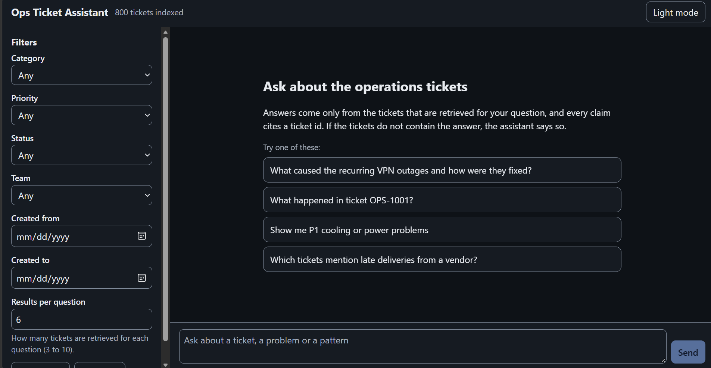

# ops-rag

Ask questions about 800 **synthetic** operations tickets (vendor invoices, VPN outages, stock shortages, access problems and so on) and get answers that cite the tickets they come from. The tickets are indexed locally; Google Gemini writes the answer from the tickets that were retrieved, and the app checks every cited ticket id against that set. A small web chat shows the answer, the ticket chips and the sources.


All data is synthetic. The tickets, names, vendors and numbers are generated by `scripts/generate_tickets.py` (seed 42); nothing in them is real.

## What it does
- **Grounded answers.** The model sees only the retrieved tickets, must cite a ticket id for every claim, and can say "not found". A cited id that was not retrieved is shown as muted text instead of a link.
- **Exact references.** Ticket ids (`OPS-1001`) and PO or invoice numbers (`PO-180649`, `INV-308701`) named in a question are looked up directly, because vector search ranks ids poorly.
- **Follow-up questions.** "What was the root cause?" after a question about one ticket is answered from that ticket; a question about something new starts a fresh search.
- **Filters.** Category, priority, status, team and a created-date range, applied to the search.
- **Ticket drawer.** Click a chip or a source to read the full ticket, including comments and the resolution.
- **Errors you can act on.** A failed request shows an inline message with Retry; a rate limit shows a countdown from the server's `Retry-After`.
- **Light and dark theme, a narrow-screen layout, keyboard operation.**




## How it works
```
data/tickets.json (800 tickets)
  -> scripts/ingest.py: one document per ticket, embedded locally (all-MiniLM-L6-v2)
  -> ChromaDB (chroma_db/, persistent, cosine similarity)

question (+ filters, + chat history)
  -> app/rag.py: exact-id lookup (OPS / PO / INV), follow-up rule, vector search above a similarity threshold (0.30)
  -> app/prompt.py: the retrieved tickets as delimited, escaped data, plus a details line per ticket
  -> app/llm.py: Gemini with a JSON schema (answer, found, citations), own retry with backoff for 429 / 503
  -> app/rag.py: citations checked against the retrieved tickets
  -> app/main.py (FastAPI) -> static/ (plain HTML, CSS and JS)
```
- **Retrieval first.** Embedding and search run on your machine. Only the question, the retrieved tickets and the last few chat turns are sent to Gemini.
- **Follow-up rule.** If a question names no ticket and only asks about a property of the previous one ("who", "when", "root cause", "it"), the ticket from the earlier turn is kept first in the context and nothing else is searched. Any other wording counts as a new topic. The rule is word-list based, so unusual wording can end the inheritance.
- **Citations.** The model's cited ids are kept only if they are in the retrieved set. Ids it mentions that were not retrieved are returned as `unverified_citations`.
- **Quota guard.** After a Gemini 429 whose retry delay is long ("quota used up") the server remembers the reset time and refuses model questions with a 429 and a `Retry-After` header until then, without sending a request.

## Quick start
You need Git, Python and a free Gemini API key ([Google AI Studio](https://aistudio.google.com/apikey), sign-in required). Needs internet for `pip` and for the first model download (about 90 MB). Tested with **Python 3.13 on Windows 11**; Python 3.11 or newer is the intended range but was not tried.

**Windows (PowerShell)**
```powershell
git clone https://github.com/ecamorais/Rag-Ops.git
cd Rag-Ops
python -m venv .venv
.venv\Scripts\Activate.ps1
pip install -r requirements.txt
copy .env.example .env
notepad .env                      # set GEMINI_API_KEY=your-key
python scripts/ingest.py --reset  # builds the local index; prints "Tickets indexed : 800"
netstat -ano | findstr :8000      # no output means port 8000 is free
uvicorn app.main:app --port 8000
```
If PowerShell blocks the activation script, skip it and call `.venv\Scripts\python` and `.venv\Scripts\uvicorn` directly.

**macOS / Linux** (the standard equivalents; not run by the author)
```bash
git clone https://github.com/ecamorais/Rag-Ops.git
cd Rag-Ops
python3 -m venv .venv
source .venv/bin/activate
pip install -r requirements.txt
cp .env.example .env
nano .env                         # set GEMINI_API_KEY=your-key
python scripts/ingest.py --reset
uvicorn app.main:app --port 8000
```

Then open <http://127.0.0.1:8000/>. If port 8000 is busy, use another one (`--port 8001`).

On the author's Windows machine a fresh install took about 3 minutes (1.4 GB virtual environment) and the first ingest, including the model download, about 1 minute. Your times will differ.

**Without a key** everything except answering works: the page, filters, ticket drawer, `/search` and `/tickets`. A question that needs the model (one for which at least one ticket was retrieved) returns the error `GEMINI_API_KEY is not set` (HTTP 500, code `server_misconfigured`); a question that retrieves nothing is answered without the model.

### Command line
```
python scripts/ask.py                       # interactive, keeps history; type "exit" to quit
python scripts/ask.py --once "What happened in ticket OPS-1001?" --priority P4-Low
python scripts/try_search.py "vpn outage" --k 3 --category Infrastructure   # search only, no model call
python scripts/generate_tickets.py          # regenerate data/ (the output is reproducible; the files are already committed)
```
`ask.py` makes real Gemini calls and accepts `--k`, `--category`, `--priority`, `--status` and `--team`.

## Things to try
- "What caused the recurring VPN outages and how were they fixed?"
- "What happened in ticket OPS-1001?", then "What was the root cause?" and "Who was the assignee?"
- "Who resolved OPS-1001?" (the ticket does not say; the answer says so)
- "Show me P1 cooling or power problems"
- "Which tickets mention late deliveries from a vendor?"

## API
JSON in and out. Errors are `{"error": "...", "code": "..."}`; a 422 from request validation uses FastAPI's usual `detail` list. Unknown request fields are rejected. Interactive docs: `/docs`.

| Method and path | What it does |
|---|---|
| `GET /health` | `status` (`ok` or `degraded`), `indexed_tickets`, `model`, `key_configured` |
| `GET /filters` | The distinct category, priority, status and team values, and `created_min` / `created_max` |
| `POST /search` | Raw vector search for debugging, no model call. Body: `query`, `k`, `filters`. Returns every hit with `similarity` and `above_threshold` |
| `GET /tickets/{id}` | The full ticket. `id` must look like `OPS-1001` (422 otherwise, 404 if unknown) |
| `POST /chat` | The answer. Body: `question`, `k`, `filters`, `history`. Returns `answer`, `found`, `citations`, `sources`, `retrieved_count`, `unverified_citations`, `missing_references`. The only route that calls Gemini |
| `GET /` and other paths | The static chat UI from `static/` |

Limits: `question` 1 to 1000 characters; `k` 1 to 15 (default 6; the UI offers 3 to 10); `history` at most 12 turns of at most 4000 characters, roles `user` and `assistant`; `filters` accepts `category`, `priority`, `status`, `team` and `date_from` / `date_to` as `YYYY-MM-DD`.

## Tests
```
python scripts/ingest.py --reset   # the test needs the index
pytest
```
`pytest` runs 26 tests in `tests/test_security_headers.py`. They start the real app on a temporary copy of `chroma_db/` (never the original), replace the model with a stub and send no request to Gemini. They check that every response, including 404, 422, 429, 503 and 500, carries the security headers, that the API docs are left alone, and that CORS still works. They need `chroma_db/`, `data/tickets.json` and the local embedding model; without an index the test is skipped with a message.

These are the only automated tests in the repository. The front end, the retrieval and the prompt were checked by hand and with scripts that are not part of this repository (see Known limits).

## Project layout
```
app/
  __init__.py      (empty, marks the package)
  config.py        settings from .env (python-dotenv)
  vectorstore.py   Chroma collection, local embedder, filters, search
  ingest.py        ticket -> document and metadata, batched upsert
  rag.py           exact-id lookup, follow-up rule, search, citation checks
  prompt.py        the system prompt and the tickets as delimited data
  llm.py           Gemini call: JSON schema, retries, quota guard
  schemas.py       request and response models, input limits
  main.py          FastAPI app: routes, CORS, security headers, errors, static mount
scripts/
  generate_tickets.py  ticket_scenarios.py   builds data/ (seeded, reproducible)
  ingest.py            index data/tickets.json into Chroma (--reset)
  try_search.py        search from the command line
  ask.py               ask questions from the command line (calls Gemini)
static/            index.html, style.css, app.js, favicon.svg (no build step)
data/              tickets.json, tickets.csv, clusters.json (800 synthetic tickets)
docs/img/          the screenshots used above
tests/             test_security_headers.py
pytest.ini         requirements.txt   requirements.lock.txt   .env.example
CLAUDE.md          developer notes and working rules
```
Generated and git-ignored: `.venv/`, `.env`, `chroma_db/`, `.cache/huggingface/` (the embedding model).

## Security notes
This is a local demo: there is no login, and CORS allows only `localhost` and `127.0.0.1` origins.
- **Content-Security-Policy** on every response except `/docs`, `/redoc` and `/openapi.json` (they load Swagger UI and ReDoc from a CDN): `default-src 'none'; script-src 'self'; style-src 'self'; connect-src 'self'; img-src 'self' data:; base-uri 'none'; form-action 'self'; frame-ancestors 'none'`, plus `X-Content-Type-Options: nosniff` and `Referrer-Policy: no-referrer`. The page uses no inline script, inline style or `innerHTML`; everything that comes from the API is shown as text.
- **Ticket text is data.** It is escaped and wrapped in delimiters in the prompt, and the system prompt tells the model to ignore instructions found in tickets or history. This was exercised with hostile text (markup and script tags in a ticket, an answer and a title), which was displayed as plain text and did nothing. It has not been tested as a prompt-injection attack against Gemini itself.
- **The API key** lives only in `.env` (git-ignored; `.env.example` has no key). The server logs one line per request (method, path, status, time) and never request bodies, headers or the key.
- **Quota and abuse.** There is no per-user rate limit; Gemini's own quota applies to your key.

## Known limits
- **Counting and ranking questions are weak.** The model only sees the top few retrieved tickets (6 by default). Asked which vendor has the most delayed-shipment tickets, it correctly said it could not tell: in the data, one vendor has three late-delivery tickets, and none of them was among the six retrieved.
- **Free-tier quota.** Gemini's free tier has rate limits. The app retries 429 and 503 with backoff and shows a clear message if it still fails; this was tested offline with simulated errors and, in a few real calls, one retry happened. A real "quota used up" response was never observed.
- **"Not found" can appear on an existing ticket.** If a ticket exists but does not state the fact asked for (for example who resolved it), the answer says so and is labelled "Not found in the tickets".
- **Lists may collapse.** The model does not always put bullets on separate lines, so a list can show as one paragraph.
- **Tested in one browser.** The UI was exercised in headless Microsoft Edge 155 only, with stubbed model answers. Not tested: Firefox, Safari, screen readers, touch devices and a real phone.
- **Real Gemini was spot-checked, not benchmarked.** Real calls (model `gemini-3.6-flash`) on 2026-10-26 exposed an over-attributed cause and a follow-up that ignored the chat history; both were fixed and re-checked. Six real calls on 2026-10-27 then matched the ticket text (one of them an honest "cannot tell"). Those calls went through the command line and the API code path, not through the browser UI, and six questions are not an accuracy measurement.
- **Platform.** Set-up and tests were run on Windows 11 with Python 3.13 only.
- **Several things are not in the repository:** the Node tests of the front end and the browser test harness. Only `tests/test_security_headers.py` is.

## Developer notes
[CLAUDE.md](CLAUDE.md) lists the stack decisions, commands, API details, known limits and the working rules used while building this project.

MIT, see [LICENSE](LICENSE).
